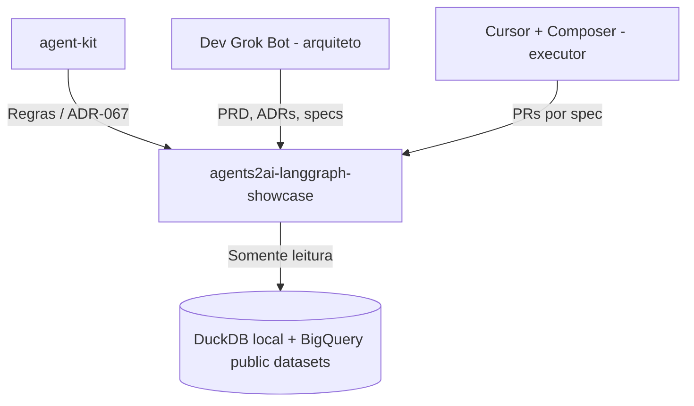

# 🤖 Contrato AI-First: agents2ai-langgraph-showcase

> **Status:** Draft v0.1 | **Persona:** Scout Architect | **Data:** 2026-10-16

## 🧭 Visão do Sistema
Repositório vitrine público da Agents2AI: agente NL→SQL em LangGraph sobre dados públicos, com HITL, guardrails, evals e tracing. Consumidor da governança do Hub `agent-kit`.

## 🏗️ Arquitetura AI-Ready (Mermaid)

## 📜 Regras de Ouro (Invariantes)
1. **Sem commit em `main`:** tudo via PR com CI verde e merge do Luciano.
2. **Somente dados públicos:** nada de cliente (nomes, dados, projetos GCP).
3. **Segredos fora do Git:** `.env`/`.secrets/` ignorados; gitleaks no CI.
4. **Uma spec = um PR:** executor não improvisa; dúvida escala ao arquiteto.

## 🛠️ Stack & Interface de IA
- **Linguagem:** Python 3.12 (uv).
- **Framework:** LangGraph; SQL: sqlglot + DuckDB/BigQuery.
- **Entry Points:** `AGENTS.md`, `docs/contracts/` (specs).

## 🚦 Definição de Pronto (DoD) para Agentes
- [ ] `uv run ruff check .` e `uv run pytest -q` verdes.
- [ ] Documentação Mermaid atualizada se houver mudança de fluxo.
- [ ] Registro no `docs/DECISIONS-LOG.md`.
