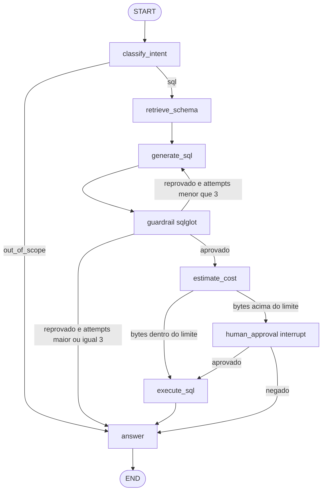

# agents2ai-langgraph-showcase

> 🇧🇷 Vitrine open source de um agente **NL→SQL** em **LangGraph**: grafo com estado tipado, checkpointing, aprovação humana para consultas caras, guardrails determinísticos de SQL, evals e tracing — sempre sobre **dados públicos** (DuckDB sintético + BigQuery `bigquery-public-data.*`).
>
> 🇺🇸 Open-source showcase of a **natural-language-to-SQL** agent on **LangGraph**: typed graph state, checkpointing, human-in-the-loop for costly queries, deterministic SQL guardrails, evals and tracing — **public data only** (synthetic DuckDB + BigQuery public datasets).

**Autor / Author:** [Luciano Teixeira](https://agents2ai.com) — AI & Data Engineer, fundador da **Agents2AI**.

| | |
|---|---|
| **Versão** | `0.0.1` (fundação do repositório) |
| **Estado do código** | Stub (`src/showcase/` + testes de fumaça); implementação segue as specs em `docs/contracts/` |
| **Estado do planejamento** | PRD, System Design, ADRs e specs **SPEC-LG-01…09** aprovados (2026-10-16) |
| **CI** | `ruff` · `pytest` · `gitleaks` (sem segredos, sem rede nos testes) |

## O que este projeto demonstra (visão alvo)

Depois das specs **01 → 07 → 06 → 09**, o repositório passa a mostrar, em código executável:

- **Orquestração LangGraph** com roteamento condicional, retry limitado de SQL e `interrupt()` para HITL.
- **Segurança em camadas:** somente leitura (sqlglot), um statement, `LIMIT`, allowlist de tabelas e bloqueio de colunas PII — validação **pós-LLM**, sem confiar no modelo.
- **Custo controlado:** estimativa via dry-run no BigQuery (fase 2); execução acima do limite só após aprovação humana.
- **Reprodutibilidade:** CI verde com LLM fake e executores locais; evals offline no golden set.
- **Observabilidade:** span por nó em `trace` + log JSON sem PII nem segredos.

Dataset de referência espelhando [`bigquery-public-data.thelook_ecommerce`](https://console.cloud.google.com/marketplace/product/bigquery-public-data/thelook-ecommerce) (decisão **D-02**). Vitrine independente no mesmo domínio do produto `agents2ai-data-copilot` (Pydantic AI).

## Arquitetura (LangGraph)

Fluxo canônico — detalhes em [`docs/contracts/202610/16/system-design-agente-nl2sql-langgraph.md`](docs/contracts/202610/16/system-design-agente-nl2sql-langgraph.md).



**Fase 1 (D-04, Docker-first):** DuckDB sintético local, CLI e compose — sem GCP.  
**Fase 2 (SPEC-LG-08, bloqueada):** BigQuery público em projeto GCP de **testes da Agents2AI** (nunca cliente).

## Rodando hoje (repositório em construção)

Pré-requisitos: **Python 3.12**, [uv](https://docs.astral.sh/uv/).

```bash
uv sync --locked --group dev
uv run ruff check .
uv run pytest -q
```

Isso espelha o job `lint-and-test` do [CI](.github/workflows/ci.yml).

### Quando a implementação estiver completa (referência)

Comandos previstos no PRD e no System Design (ainda **não** disponíveis até as specs correspondentes):

```bash
# CLI com checkpoint SQLite e HITL interativo (SPEC-LG-05)
uv run showcase ask "qual a receita por categoria em 2023?"

# Evals offline (CI) ou online com .env local (SPEC-LG-06)
uv run python -m showcase.evals --offline

# Fase 1 containerizada (SPEC-LG-07)
docker compose run --rm showcase ask "..."
```

Variáveis de ambiente (sem valores no Git): ver System Design §8 e `.env.example` (criado na SPEC-LG-01). Chaves só em `.env` local — nunca commitar.

## Documentação (fonte da verdade)

| Documento | Conteúdo |
|-----------|----------|
| [`AGENTS.md`](AGENTS.md) | Regras para agentes de IA e devs (Git, segurança, portões, DoD) |
| [`docs/contracts/202610/16/guia-executor-cursor-composer.md`](docs/contracts/202610/16/guia-executor-cursor-composer.md) | Como executar **uma spec por vez** no Cursor (Composer) |
| [`docs/contracts/202610/16/prd-agente-nl2sql-langgraph.md`](docs/contracts/202610/16/prd-agente-nl2sql-langgraph.md) | PRD, métricas de sucesso, escopo |
| [`docs/contracts/202610/16/system-design-agente-nl2sql-langgraph.md`](docs/contracts/202610/16/system-design-agente-nl2sql-langgraph.md) | Grafo, estado, nós, deps, HITL, guardrail, config |
| [`docs/DECISIONS-LOG.md`](docs/DECISIONS-LOG.md) | ADRs aceitas e decisões D-01…D-05 |
| [`docs/decisions/202610/16/`](docs/decisions/202610/16/) | ADR-001…006 (LangGraph, dados, LLM, observabilidade, guardrails, schema VSS) |
| [`docs/contracts/202610/16/spec-lg-*.md`](docs/contracts/202610/16/) | Specs de implementação ordenadas |

### Ordem de implementação (specs)

| # | Spec | Foco |
|---|------|------|
| 1 | [SPEC-LG-01](docs/contracts/202610/16/spec-lg-01-fundacao-grafo.md) | Deps, settings, estado, grafo stub |
| 2 | [SPEC-LG-02](docs/contracts/202610/16/spec-lg-02-guardrail-sql.md) | Guardrail sqlglot |
| 3 | [SPEC-LG-03](docs/contracts/202610/16/spec-lg-03-duckdb-dataset-executor.md) | DuckDB sintético + executor |
| 4 | [SPEC-LG-04](docs/contracts/202610/16/spec-lg-04-nos-llm.md) | Nós LLM + retry |
| 5 | [SPEC-LG-05](docs/contracts/202610/16/spec-lg-05-hitl-sqlite-cli.md) | HITL, SqliteSaver, CLI |
| 6 | [SPEC-LG-07](docs/contracts/202610/16/spec-lg-07-docker-compose.md) | Dockerfile + compose |
| 7 | [SPEC-LG-06](docs/contracts/202610/16/spec-lg-06-tracing-evals-readme.md) | Tracing, evals, README vitrine |
| 8 | [SPEC-LG-09](docs/contracts/202610/16/spec-lg-09-schema-retrieval-vss.md) | Schema por similaridade (DuckDB VSS) |
| — | [SPEC-LG-08](docs/contracts/202610/16/spec-lg-08-fase2-bigquery-publico.md) | **Bloqueada** — BigQuery fase 2 |

Modelo arquiteto → executor: planner (**Dev Grok Bot**) produz contratos; executor (**Cursor + Composer**) implementa cada spec; aceite e merge: Luciano Teixeira (ADR-067 do Hub `agent-kit`).

## Stack

| Camada | Tecnologia (versões fixadas nas specs / lock) |
|--------|-----------------------------------------------|
| Runtime | Python 3.12, uv |
| Orquestração | LangGraph, langgraph-checkpoint-sqlite |
| SQL | sqlglot (guardrail), DuckDB (fase 1), BigQuery public (fase 2) |
| LLM | API OpenAI-compatível via [OpenRouter](https://openrouter.ai) — padrão `nvidia/nemotron-3.5-lightning` (D-03) |
| Qualidade | pytest, ruff, gitleaks |

## Invariantes de segurança

1. **Somente dados públicos** — nenhum dado, nome ou projeto GCP de cliente.
2. **SQL somente leitura** — validado deterministicamente; `LIMIT` obrigatório; PII bloqueada.
3. **Consultas caras** — pausa com `interrupt()` até aprovação humana.
4. **Segredos** — apenas em `.env`; logs e traces sem pergunta, SQL sensível ou chaves.

## Licença

MIT — ver [`LICENSE`](LICENSE).
